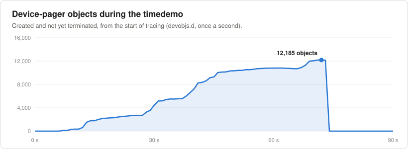
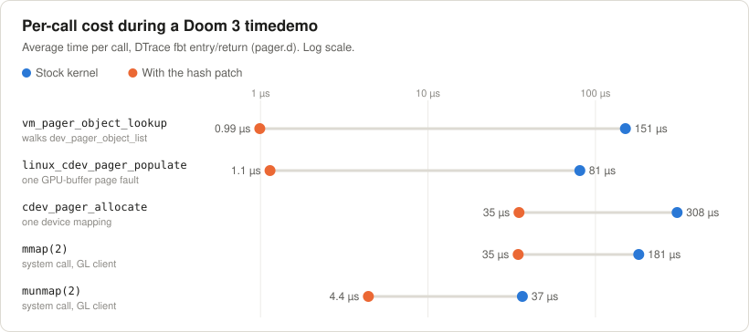
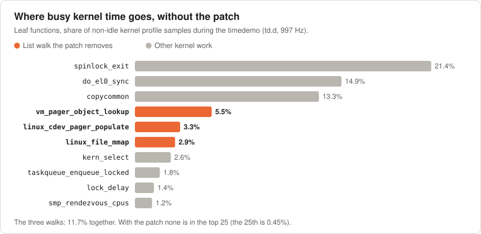
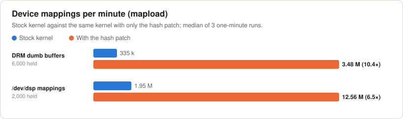

# Device-pager hash lookups: measurements

How the numbers for the parent commit (`device_pager, linuxkpi: look device
mappings up by hash, not list walk`) were taken, with the scripts used, so
they can be checked and repeated.

Everything here was measured on arm64 16-CURRENT (8 vCPUs) with virtio-gpu,
drm-kmod and Mesa virgl. The workload is a Doom 3 (dhewm3) timedemo, demo1
at 1024x768, plus a synthetic mapping load (`mapload.c`).

## The problem in one picture

Mesa keeps its buffer objects mapped, so the number of device-pager
objects in the system grows with every texture and vertex buffer a GL
program holds. Every device `mmap(2)` walks all of them in
`cdev_pager_allocate()` (`vm_pager_object_lookup()`, twice for a new object),
and every page fault on a LinuxKPI mapping walks the matching list of
`vm_area_struct`s in `linux_cdev_handle_find()`. Both walks run under a
global lock.



At the peak, each lookup walks about 12,000 entries.

## Results



| | stock | with the patch |
|---|---|---|
| `vm_pager_object_lookup`, per call | 151 µs (27,266 calls, 4.12 s) | 0.99 µs (24,664 calls, 0.024 s) |
| `linux_cdev_pager_populate` (one fault) | 80.7 µs (32,276 calls, 2.61 s) | 1.14 µs (32,181 calls, 0.037 s) |
| `cdev_pager_allocate`, per call | 308 µs | 35 µs |
| `mmap(2)` by the GL client | 181 µs | 35 µs |
| `munmap(2)` by the GL client | 36.7 µs | 4.4 µs |
| timedemo, same light sampler running both times | 45.5–46.2 fps | 47.4–47.8 fps |

The "with the patch" column comes from a development kernel carrying the
patch. Rebuilt with only this patch on the same base, the kernel measured
1.46 µs per lookup and 1.34 µs per fault, and ran the timedemo at 47.6 fps
traced and 48.0 fps untraced.





| mapload, device maps per minute (3 runs each) | stock | with only the patch |
|---|---|---|
| DRM dumb buffers, 6,000 held | 327,945 / 334,644 / 381,975 | 3,393,715 / 3,483,699 / 3,487,955 |
| `/dev/dsp` mappings, 2,000 held | 1,933,052 / 1,945,042 / 1,952,500 | 12,303,247 / 12,561,466 / 13,170,584 |

Without the patch, a mapping costs more the more buffers are mapped anywhere
in the system. With it, the cost hardly changes with the number of buffers.

## Files

| file | what it is |
|---|---|
| `pager.d` | per-call count, total and distribution of time for `linux_cdev_pager_populate`, `cdev_pager_allocate`, `vm_pager_object_lookup`, and the GL client's `mmap`, `munmap` and faults (fbt entry/return) |
| `td.d` | the leaf-function kernel profile (997 Hz) plus exact time and calls of the lookup and the fault, during a timedemo |
| `devobjs.d` | live device-pager objects once a second (allocated as `OBJT_DEVICE`/`OBJT_MGTDEVICE` and not yet terminated) |
| `mapload.c` | the synthetic load: keeps N device buffers mapped while threads map, touch and unmap one more in a loop |
| `devobjs-timedemo.txt` | `devobjs.d` output for the object chart (seconds, objects) |
| `gen-charts.py` | draws the four charts in `charts/` from the numbers above |

The profile uses leaf functions only because pointer authentication on
arm64 keeps DTrace's `stack()` from unwinding out of the profile provider.
The fbt timings are not affected.

## Reproducing

Per-call costs, across one timedemo (`EXECNAME` is the GL client's process
name):

```sh
dtrace -s pager.d 200 EXECNAME -o pager.out &
# run the timedemo
```

Profile, and lookup and fault totals:

```sh
dtrace -s td.d 200 -o td.out &
# run the timedemo
```

Object count over time (start it before the game):

```sh
dtrace -s devobjs.d 170 -o devobjs.out
```

Synthetic load, one minute each. DRM mode needs the card (group `video`),
and sound mode needs `/dev/dspN` (group `audio` on 16-CURRENT):

```sh
cc -O2 -Wall -o mapload mapload.c -lpthread
./mapload -H 6000              # DRM dumb buffers on /dev/dri/card0
./mapload -S /dev/dsp0 -H 2000 # sound buffers, no GPU needed
```

Charts:

```sh
python3 gen-charts.py devobjs-timedemo.txt charts
```
